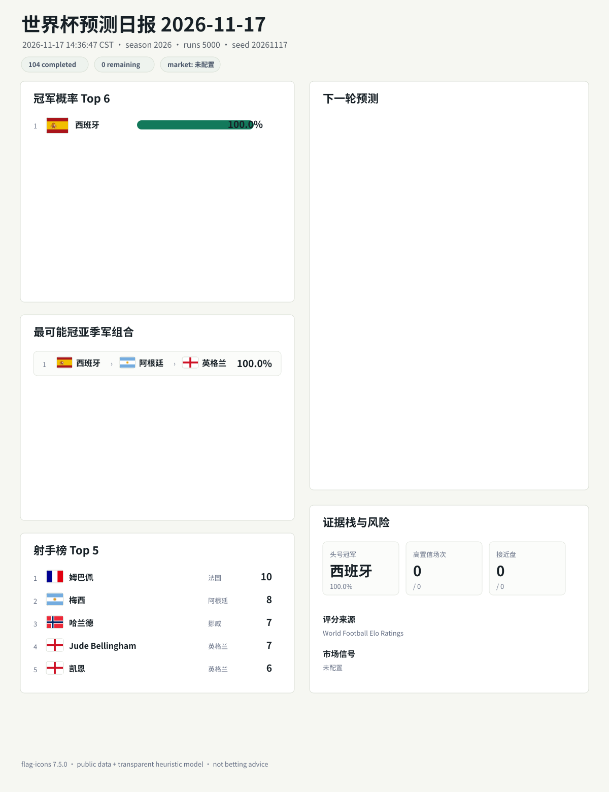

# 世界杯预测日报 2026-11-17

生成时间: 2026-11-17 14:36:47 CST | 赛季: 2026
最终排名模拟次数: 5000 | 随机种子: 20261117 | 市场信号: 未配置

本报告基于公开赛事数据、透明启发式模型和可选赔率/预测市场信号生成，仅作方向性预测，不是投注建议。

## 今日结论

- 冠军主线：西班牙 以 `100.0%` 排在第一。
- 下一轮：`0` 场是高置信方向，`0` 场是低置信接近盘。
- 市场信号：未配置。

## 可审计明细

### 当前概况

| 项目 | 数值 |
| --- | --- |
| 已完赛场次 | 104 |
| 剩余场次 | 0 |
| 下一轮未赛轮次 | 无 |
| 下一场未赛日期 | 无 |

### 射手榜
| 球员 | 球队 | 进球 |
| --- | --- | --- |
| 姆巴佩 | 法国 | 10 |
| 梅西 | 阿根廷 | 8 |
| 哈兰德 | 挪威 | 7 |
| Jude Bellingham | 英格兰 | 7 |
| 凯恩 | 英格兰 | 6 |
| 登贝莱 | 法国 | 6 |
| 奥亚萨瓦尔 | 西班牙 | 5 |
| 伊斯梅拉·萨尔 | 塞内加尔 | 4 |
| 基尼奥内斯 | 墨西哥 | 4 |
| 维尼修斯 | 巴西 | 4 |
| Bradley Barcola | 法国 | 3 |
| 布罗贝 | 荷兰 | 3 |
| Bukayo Saka | 英格兰 | 3 |
| Charles De Ketelaere | 比利时 | 3 |
| 加克波 | 荷兰 | 3 |
| C 罗 | 葡萄牙 | 3 |
| 昂达夫 | 德国 | 3 |
| 伊莱贾·贾斯特 | 新西兰 | 3 |
| 巴洛贡 | 美国 | 3 |
| 赛巴里 | 摩洛哥 | 3 |

### 小组积分榜
#### A 组
| 球队 | 赛 | 分 | 胜 | 平 | 负 | 进 | 失 | 净胜 |
| --- | --- | --- | --- | --- | --- | --- | --- | --- |
| 墨西哥 | 3 | 9 | 3 | 0 | 0 | 6 | 0 | 6 |
| 南非 | 3 | 4 | 1 | 1 | 1 | 2 | 3 | -1 |
| 韩国 | 3 | 3 | 1 | 0 | 2 | 2 | 3 | -1 |
| 捷克 | 3 | 1 | 0 | 1 | 2 | 2 | 6 | -4 |

#### B 组
| 球队 | 赛 | 分 | 胜 | 平 | 负 | 进 | 失 | 净胜 |
| --- | --- | --- | --- | --- | --- | --- | --- | --- |
| 瑞士 | 3 | 7 | 2 | 1 | 0 | 7 | 3 | 4 |
| 加拿大 | 3 | 4 | 1 | 1 | 1 | 8 | 3 | 5 |
| 波黑 | 3 | 4 | 1 | 1 | 1 | 5 | 6 | -1 |
| 卡塔尔 | 3 | 1 | 0 | 1 | 2 | 2 | 10 | -8 |

#### C 组
| 球队 | 赛 | 分 | 胜 | 平 | 负 | 进 | 失 | 净胜 |
| --- | --- | --- | --- | --- | --- | --- | --- | --- |
| 巴西 | 3 | 7 | 2 | 1 | 0 | 7 | 1 | 6 |
| 摩洛哥 | 3 | 7 | 2 | 1 | 0 | 6 | 3 | 3 |
| 苏格兰 | 3 | 3 | 1 | 0 | 2 | 1 | 4 | -3 |
| 海地 | 3 | 0 | 0 | 0 | 3 | 2 | 8 | -6 |

#### D 组
| 球队 | 赛 | 分 | 胜 | 平 | 负 | 进 | 失 | 净胜 |
| --- | --- | --- | --- | --- | --- | --- | --- | --- |
| 美国 | 3 | 6 | 2 | 0 | 1 | 8 | 4 | 4 |
| 澳大利亚 | 3 | 4 | 1 | 1 | 1 | 2 | 2 | 0 |
| 巴拉圭 | 3 | 4 | 1 | 1 | 1 | 2 | 4 | -2 |
| 土耳其 | 3 | 3 | 1 | 0 | 2 | 3 | 5 | -2 |

#### E 组
| 球队 | 赛 | 分 | 胜 | 平 | 负 | 进 | 失 | 净胜 |
| --- | --- | --- | --- | --- | --- | --- | --- | --- |
| 德国 | 3 | 6 | 2 | 0 | 1 | 10 | 4 | 6 |
| 科特迪瓦 | 3 | 6 | 2 | 0 | 1 | 4 | 2 | 2 |
| 厄瓜多尔 | 3 | 4 | 1 | 1 | 1 | 2 | 2 | 0 |
| 库拉索 | 3 | 1 | 0 | 1 | 2 | 1 | 9 | -8 |

#### F 组
| 球队 | 赛 | 分 | 胜 | 平 | 负 | 进 | 失 | 净胜 |
| --- | --- | --- | --- | --- | --- | --- | --- | --- |
| 荷兰 | 3 | 7 | 2 | 1 | 0 | 10 | 4 | 6 |
| 日本 | 3 | 5 | 1 | 2 | 0 | 7 | 3 | 4 |
| 瑞典 | 3 | 4 | 1 | 1 | 1 | 7 | 7 | 0 |
| 突尼斯 | 3 | 0 | 0 | 0 | 3 | 2 | 12 | -10 |

#### G 组
| 球队 | 赛 | 分 | 胜 | 平 | 负 | 进 | 失 | 净胜 |
| --- | --- | --- | --- | --- | --- | --- | --- | --- |
| 比利时 | 3 | 5 | 1 | 2 | 0 | 6 | 2 | 4 |
| 埃及 | 3 | 5 | 1 | 2 | 0 | 5 | 3 | 2 |
| 伊朗 | 3 | 3 | 0 | 3 | 0 | 3 | 3 | 0 |
| 新西兰 | 3 | 1 | 0 | 1 | 2 | 4 | 10 | -6 |

#### H 组
| 球队 | 赛 | 分 | 胜 | 平 | 负 | 进 | 失 | 净胜 |
| --- | --- | --- | --- | --- | --- | --- | --- | --- |
| 西班牙 | 3 | 7 | 2 | 1 | 0 | 5 | 0 | 5 |
| 佛得角 | 3 | 3 | 0 | 3 | 0 | 2 | 2 | 0 |
| 乌拉圭 | 3 | 2 | 0 | 2 | 1 | 3 | 4 | -1 |
| 沙特阿拉伯 | 3 | 2 | 0 | 2 | 1 | 1 | 5 | -4 |

#### I 组
| 球队 | 赛 | 分 | 胜 | 平 | 负 | 进 | 失 | 净胜 |
| --- | --- | --- | --- | --- | --- | --- | --- | --- |
| 法国 | 3 | 9 | 3 | 0 | 0 | 10 | 2 | 8 |
| 挪威 | 3 | 6 | 2 | 0 | 1 | 8 | 7 | 1 |
| 塞内加尔 | 3 | 3 | 1 | 0 | 2 | 8 | 6 | 2 |
| 伊拉克 | 3 | 0 | 0 | 0 | 3 | 1 | 12 | -11 |

#### J 组
| 球队 | 赛 | 分 | 胜 | 平 | 负 | 进 | 失 | 净胜 |
| --- | --- | --- | --- | --- | --- | --- | --- | --- |
| 阿根廷 | 3 | 9 | 3 | 0 | 0 | 8 | 1 | 7 |
| 奥地利 | 3 | 4 | 1 | 1 | 1 | 6 | 6 | 0 |
| 阿尔及利亚 | 3 | 4 | 1 | 1 | 1 | 5 | 7 | -2 |
| 约旦 | 3 | 0 | 0 | 0 | 3 | 3 | 8 | -5 |

#### K 组
| 球队 | 赛 | 分 | 胜 | 平 | 负 | 进 | 失 | 净胜 |
| --- | --- | --- | --- | --- | --- | --- | --- | --- |
| 哥伦比亚 | 3 | 7 | 2 | 1 | 0 | 4 | 1 | 3 |
| 葡萄牙 | 3 | 5 | 1 | 2 | 0 | 6 | 1 | 5 |
| 刚果民主共和国 | 3 | 4 | 1 | 1 | 1 | 4 | 3 | 1 |
| 乌兹别克斯坦 | 3 | 0 | 0 | 0 | 3 | 2 | 11 | -9 |

#### L 组
| 球队 | 赛 | 分 | 胜 | 平 | 负 | 进 | 失 | 净胜 |
| --- | --- | --- | --- | --- | --- | --- | --- | --- |
| 英格兰 | 3 | 7 | 2 | 1 | 0 | 6 | 2 | 4 |
| 克罗地亚 | 3 | 6 | 2 | 0 | 1 | 5 | 5 | 0 |
| 加纳 | 3 | 4 | 1 | 1 | 1 | 2 | 2 | 0 |
| 巴拿马 | 3 | 0 | 0 | 0 | 3 | 0 | 4 | -4 |

### 公开评分
| 球队 | Elo 排名 | Elo | FIFA 排名 | FIFA 积分 |
| --- | --- | --- | --- | --- |
| 西班牙 | 1 | 2258 |  |  |
| 英格兰 | 2 | 2182 |  |  |
| 阿根廷 | 3 | 2157 |  |  |
| 法国 | 4 | 2069 |  |  |
| 葡萄牙 | 5 | 1996 |  |  |
| 比利时 | 6 | 1994 |  |  |
| 哥伦比亚 | 7 | 1992 |  |  |
| 荷兰 | 8 | 1990 |  |  |
| 巴西 | 9 | 1982 |  |  |
| 瑞士 | 10 | 1967 |  |  |
| 德国 | 13 | 1916 |  |  |
| 日本 | 13 | 1916 |  |  |
| 挪威 | 15 | 1909 |  |  |
| 摩洛哥 | 16 | 1898 |  |  |
| 乌拉圭 | 17 | 1869 |  |  |
| 克罗地亚 | 18 | 1858 |  |  |
| 厄瓜多尔 | 19 | 1852 |  |  |
| 奥地利 | 20 | 1849 |  |  |
| 巴拉圭 | 21 | 1838 |  |  |
| 墨西哥 | 22 | 1837 |  |  |
| 塞内加尔 | 23 | 1808 |  |  |
| 美国 | 24 | 1803 |  |  |
| 澳大利亚 | 25 | 1794 |  |  |
| 瑞典 | 28 | 1784 |  |  |
| 加拿大 | 30 | 1753 |  |  |
| 土耳其 | 31 | 1750 |  |  |
| 伊朗 | 32 | 1748 |  |  |
| 阿尔及利亚 | 33 | 1746 |  |  |
| 科特迪瓦 | 35 | 1728 |  |  |
| 苏格兰 | 37 | 1724 |  |  |
| 埃及 | 39 | 1719 |  |  |
| 韩国 | 40 | 1717 |  |  |
| 巴拿马 | 53 | 1661 |  |  |
| 沙特阿拉伯 | 54 | 1652 |  |  |
| 捷克 | 56 | 1647 |  |  |
| 乌兹别克斯坦 | 57 | 1636 |  |  |
| 约旦 | 62 | 1622 |  |  |
| 南非 | 66 | 1580 |  |  |
| 佛得角 | 69 | 1566 |  |  |
| 新西兰 | 72 | 1563 |  |  |
| 海地 | 73 | 1552 |  |  |
| 伊拉克 | 74 | 1534 |  |  |
| 加纳 | 81 | 1514 |  |  |
| 突尼斯 | 84 | 1485 |  |  |
| 库拉索 | 85 | 1484 |  |  |
| 卡塔尔 | 88 | 1461 |  |  |

| 项目 | 数值 |
| --- | --- |
| 评分来源 | World Football Elo Ratings |

### 下一轮预测

| 项目 | 数值 |
| --- | --- |
| 轮次 | 暂无未赛轮次 |
| 评分来源 | World Football Elo Ratings |
| 市场来源 | 无 |

| 日期 | 球队 1 | 球队 2 | 状态 | 球队 1 | 平局 | 球队 2 | 市场信号 |
| --- | --- | --- | --- | --- | --- | --- | --- |

### 最终预测

| 项目 | 数值 |
| --- | --- |
| 模拟次数 | 5000 |
| 随机种子 | 20261117 |
| 方法 | 透明启发式评分加剩余赛程蒙特卡洛模拟。 |
| 评分来源 | World Football Elo Ratings |
| 市场来源 | 无 |

### 最可能冠亚季军组合
| 冠军 | 亚军 | 第三名 | 概率 |
| --- | --- | --- | --- |
| 西班牙 | 阿根廷 | 英格兰 | 100.0% |

### 冠军
| 球队 | 概率 |
| --- | --- |
| 西班牙 | 100.0% |

### 亚军
| 球队 | 概率 |
| --- | --- |
| 阿根廷 | 100.0% |

### 第三名
| 球队 | 概率 |
| --- | --- |
| 英格兰 | 100.0% |

### 第四名
| 球队 | 概率 |
| --- | --- |
| 法国 | 100.0% |
